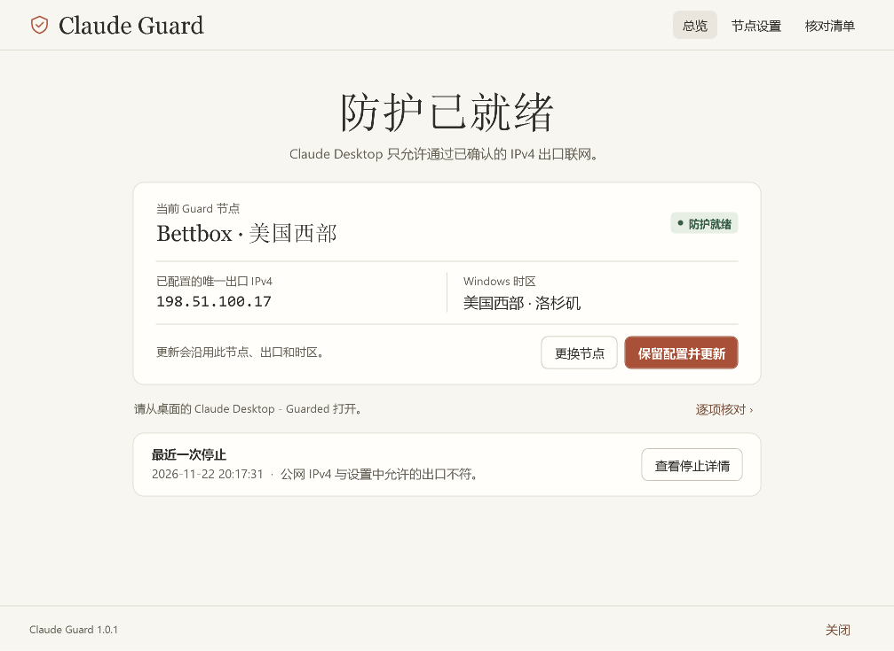

# Claude Guard

Claude Guard is a Windows x64 tool for keeping the Microsoft Store edition of Claude Desktop on one approved Bettbox IPv4 exit. A single health-check timeout triggers another check. When Guard confirms that the channel has failed, it closes the protected application's network access before stopping it. The user reopens Claude Desktop after restoring the proxy.

## Native Guard 1.0.9 source preview

The Native Guard preview uses the Windows Firewall with a full-tunnel VPN. It adds guarded desktop and native CLI launch, an optional background refresh, session time zone recovery, encrypted DNS controls, and an independent Windows region and default input window. [Native source, build steps and verification status](native/README.md)

## What's new in 1.0.4

- Review the selected Bettbox node and verified exit alongside the Windows time zone, country or region, regional format, preferred languages, and Edge website languages. Settings that have more than one valid regional choice ask you to choose.
- Repair the current user's regional settings when Guard verifies the existing route and exit but the Store registration check blocks a protection update. The repair reports the existing protection status separately and rechecks Windows preferred languages after they have had time to settle.
- Open Edge's website-language settings when the profile is busy. A separate, explicit check opens a local page and shows the language preference that Edge actually sent. The setup window reports display languages and the default input method separately.

## Source availability

This repository publishes the original Claude Guard source and test fixtures. The complete 1.0.4 installer and source archive contain eight inherited scripts from gruskry/claude-vpn-guard. The pinned upstream revision lacks a published redistribution license. The original installer and complete archive remain private pending confirmation of the terms. Building the full installer requires the omitted scripts and pinned dependencies. [Third-party notices](NOTICE.md)

The SHA-256 files identify the original local installer and complete source ZIP for each version. [1.0.4 checksums](checksums/ClaudeGuardSetup-1.0.4-SHA256.txt) · [1.0.1 checksums](checksums/ClaudeGuardSetup-1.0.1-SHA256.txt)

## Try the interface

On Windows x64 with the .NET Framework WPF components and 64-bit Windows PowerShell 5.1, run the native window fixture from the checkout root.

~~~powershell
powershell.exe -NoProfile -STA -ExecutionPolicy Bypass -File ./tests/setup-native-window-tests.ps1
~~~

The fixture opens the WPF setup window with sample data and mock actions. It exercises node changes, regional choices, verification progress, recovery, and stop details without using Claude Desktop or a live proxy. [Example exit details from 1.0.1](docs/images/observed-exit.png)

## Repository layout

- `package/` contains the Windows protection components included in the public snapshot.
- `native/` contains the project-owned Native Guard 1.0.9 implementation and offline tests.
- `release/` contains the WPF host, setup actions, build logic, and region catalog.
- `runtime/` contains the exit observer.
- `tests/` contains fixtures and their dependencies. Some integration suites require the full runtime. [Test instructions](tests/README.md)
- `tools/` contains optional local diagnostics.

The project's original components are distributed under GPL-3.0. Third-party components retain their respective terms. [Project license](LICENSE) · [Third-party notices](NOTICE.md)
