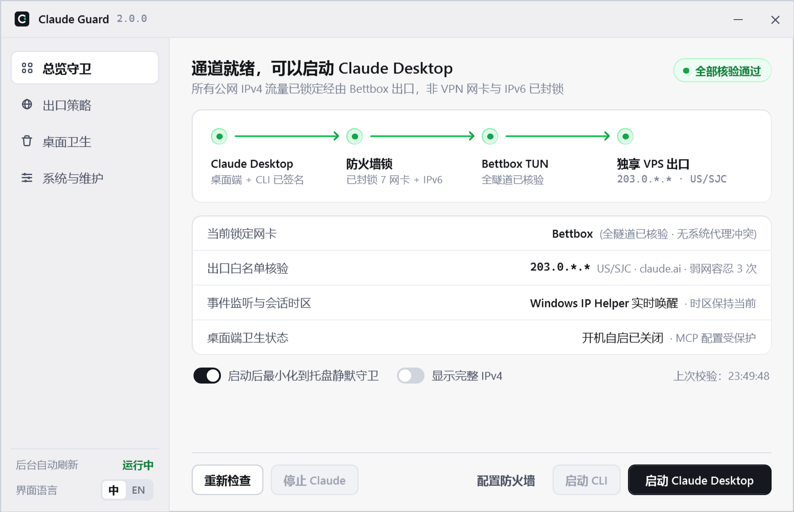

# Claude Guard（本机 Windows 防火墙与出口守卫）

[English](README.md) · [简体中文](README.zh-CN.md)

**Claude Guard Native** 是一个开源、零外部 SDK 依赖的 Windows x64 本机守卫工具，面向 **Claude Desktop** 与原生 **Claude Code CLI**。它校验 Windows 公网 IPv4 路由是否统一落在已识别的全隧道 VPN / TUN 网卡上，通过 Windows Defender 防火墙为已识别的 Anthropic 签名程序及 Microsoft Store 包阻断非 VPN 网卡出站与 IPv6，在会话期间通过 Windows IP Helper 事件监听网络变化，并支持可选的只读 IPv4 TLS 公网出口核验、MCP 保护型桌面卫生清理以及可逆的时区、区域/输入法和加密 DNS（DoH）控制。

> **重要边界声明**：本工具仅负责 Windows 本机的路由校验、防火墙阻断与系统设置核验，**不能改变** Anthropic 的[支持地区政策](https://www.anthropic.com/legal/supported-regions)，也**不保证**账号不会被限制或封禁。使用前请先阅读[已知边界与限制](native/LIMITATIONS.md)。

<p align="center">
  
</p>

## 重大版本发布：Native Guard 2.0.0

- **全新原生 WPF 桌面端（~313 KB 零外部依赖）**：彻底告别老旧 WinForms，基于 Windows 系统内置 `.NET Framework` 原生 WPF（`WindowChrome` + Win11 原生圆角）1:1 重构。采用无边框 4 标签统一架构（**总览守卫 / 出口策略 / 桌面卫生 / 系统与维护**）、实时 **4 节点通道电路图**（直观标出放行链路或精确断点）、集中式可维护样式表（`native/ui/Theme.xaml`），以及全新纯矢量 **精密门闸 (Aperture Gate)** 多分辨率应用图标与系统托盘三态 LED（绿就绪 / 琥珀提醒 / 红熔断）。
- **可选只读公网 IPv4 出口核验（Fail-Closed + 弱网防误杀）**：开启后在启动前与会话期间直接通过 IPv4 TLS 请求 `https://<目标域名>/cdn-cgi/trace`（默认 `claude.ai`，不经过系统代理），按用户配置的允许国家码和/或独享 VPS IPv4 白名单核验；明确返回非白名单 IP/国家时 **0 容忍立即拦截**，而偶发丢包/超时支持可配置连续重试（默认 3 次，专为 HY2/CDN 抖动优化），界面与报告默认脱敏显示（`203.0.*.*`）。
- **事件驱动 + 分层会话监控**：通过 Windows IP Helper（`NotifyRouteChange2` / `NotifyIpInterfaceChange`）在路由或网卡变化时即时唤醒核验，并在平稳周期缓存耗时的磁盘与 Store 扫描，兼顾秒级响应与极低后台占用。
- **Claude Desktop 卫生体检、MCP 强保护清理与日常静默守卫**：扫描传统版与 Microsoft Store MSIX 版 Claude Desktop 数据目录及 Windows 开机自启项（防 Bettbox TUN 未就绪时抢跑）；一键归档清理旧缓存/Cookie/会话/日志并支持一键还原，**强制跳过并保留 `claude_desktop_config.json`（MCP 配置）**；支持启动后自动最小化到托盘静默守卫、一键安全结束 Claude 进程树（`--stop-claude`）与一键创建桌面受守卫快捷方式（`--launch-desktop`）。
- **精细化代理 / WPAD 冲突诊断**：明确区分进程环境变量、Windows 手动代理、PAC 脚本、WPAD 自动检测与 WinHTTP 代理，拦截时内联给出修复指引并直达 Windows 代理设置页。
- **实时中英双语切换与完整命令行套件**：侧栏底部一键切换 `中 | EN`，内置区域/输入法工具（`--region`）、会话临时时区自动恢复、加密 DNS（DoH）、安装包 SHA-256 校验（`--verify-package`）与脱敏诊断报告导出。

👉 **[Native Guard 2.0.0 详细说明、命令行与构建指南](native/README.md)** · **[已知边界与限制](native/LIMITATIONS.md)** · **[发布页 (Releases)](https://github.com/jamesmendax/claude-guard/releases)**

### 快速构建与离线测试（Windows x64）

```powershell
.\native\Build-NativeGuard.ps1
.\native\Test-NetworkAdapters.ps1
.\native\Test-FirewallPolicy.ps1
.\native\Test-NativeGuard.ps1
.\native\Test-ExitAndMonitor.ps1
```

只读检查当前宿主机状态并生成实机/虚拟机手动验收清单：

```powershell
.\native\Verify-LiveGuard.ps1
```

可选：如本机装有 Inno Setup 6，可基于 `native\.build\` 产物编译标准图形安装器：

```powershell
iscc .\native\installer\ClaudeGuardNative.iss
```

---

## 历史源码归档：Claude Guard 1.0.1–1.0.4（Bettbox / WFP 旧路线）

仓库中的 `package/`、`release/`、`runtime/`、`tests/` 与 `tools/` 目录保留了早期 **Claude Guard 1.0.4** 的原创源码与测试夹具。

- 由于 1.0.4 完整安装包曾依赖 `gruskry/claude-vpn-guard` 的 8 个历史脚本（其锁定版本未附带再分发许可证），这些脚本和完整 1.0.4 安装包未纳入公开仓库，因此**不能从本公开仓库直接构建 1.0.4 完整安装包**。
- 如需可直接从公开源码完整构建并运行的成品，请使用 [`native/`](native/) 目录下的 **Native Guard 2.0.0**。
- 第三方声明见 [NOTICE.md](NOTICE.md)，历史校验和见 [checksums/](checksums/)。

## 仓库目录结构

- `native/` — **当前活跃主线**：Native Guard 2.0.0 完整源码（含 `ui/` 原生 WPF 模块与 `assets/` 矢量图标）、107 项离线测试套件、只读实机验收脚本、Inno Setup 脚本与已知边界文档。
- `.github/workflows/native-guard-ci.yml` — Windows 自动化 CI，覆盖 Windows PowerShell 5.1 与 PowerShell 7 构建和全部离线测试。
- `package/`、`release/`、`runtime/`、`tests/`、`tools/` — 历史 1.0.4 Bettbox/WFP 公开源码归档与测试夹具。

项目原创部分采用 [GPL-3.0](LICENSE) 开源协议，第三方组件条款见 [NOTICE.md](NOTICE.md)。
